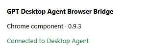

## הבעיה והמטרה

זרימות עבודה עסקיות משלבות אתרי אינטרנט, קבצים ויישומי שולחן עבודה. הפרויקט מרכז פעולות חוזרות דרך ממשק כלים אחיד, תוך הגדרה מפורשת של היעד והפעולה בכל בקשה.

## מה פותח

- שרת MCP שחושף כלים עם קלט מובנה לפעולות דפדפן, תהליכים, קבצים וממשק Windows.
- שירות מקומי ב־Python שמנתב בקשות לשכבת הביצוע. תוסף Chrome מגשר בין השירות ללשוניות הדפדפן ומחזיר מידע על התוצאה.
- מסלול חיבור מרחוק עם תווך מאומת ו־Cloudflare Tunnel. פעולת דפדפן יכולה לציין מופע ולשונית מפורשים כדי לצמצם סיכון להפעלה בהקשר שגוי.

## האתגר הטכני

כשל בקריאת המצב אחרי פעולה שונה מכשל בביצוע הפעולה עצמה. שכבת הבקרה מחזירה את שני המצבים בנפרד, כדי לאפשר קריאת מצב מחדש בלי לבצע שוב פעולה שכבר הושלמה. יש גם בדיקות קלט, הגבלת תחומי קבצים ודרישות אימות בשכבת התווך.

## בדיקות ואימות

קוד הבדיקות מכסה דחיית בקשות לא תקינות, אימות החיבור, ניתוב לפי מופע ולשונית, והתנהגות אחרי כשל בקריאת מצב. בעת הכנת תיק העבודות נבדק החיבור למחשב בפועל והתקבל אישור שהתוסף מחובר. זהו כלי בסביבת עבודה אישית.

<figure class="evidence-capture">
  
  <figcaption>צילום תוסף Chrome מהמחשב המחובר. התצוגה נחתכה לשם הצגת סטטוס החיבור בלבד.</figcaption>
</figure>
