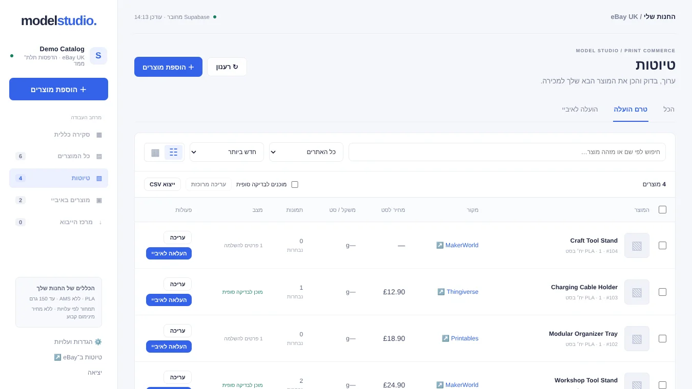

## הבעיה והמטרה

פרסום מוצר דורש לחבר מפרט, תמונות, טקסט מכירה ודרישות קטגוריה של זירת המסחר. המערכת שומרת את הפרטים ברשומת מוצר אחת ומאפשרת לבדוק את הטיוטה לפני השליחה.

## מה פותח

- קטלוג ועריכת מוצר בממשק Web, עם יצירה ידנית וייבוא ממקורות חיצוניים. תוסף Chrome מסייע בקליטה ממקורות שנפתחים בדפדפן.
- Cloudflare Worker שמטפל בבקשות ו־Supabase כשכבת האחסון. החיבור ל־eBay משתמש ב־OAuth, ופרטי ההרשאה נשמרים מוצפנים בצד השרת.
- הכנת הצעה לפי דרישות קטגוריה ומדיניות חשבון, ופרסום בפעולה נפרדת לאחר בדיקות מוכנות. מסלול נוסף קורא את מצב המודעה הקיימת ומעדכן שדות ותמונות באותו מזהה מודעה, עבור מודעות נתמכות במחיר קבוע.

## האתגר הטכני

תוצאת פרסום יכולה להיות עמומה אם החיבור מתנתק אחרי השליחה. המערכת מעבירה מקרים כאלה לבדיקה מול eBay לפני ניסיון נוסף. בעריכת מודעה קיימת, נשמרת תמונת מצב שמאפשרת לזהות שינוי מקביל לפני החלת העדכון.

## בדיקות ואימות

במאגר קיימות בדיקות לפרסום, עריכת מודעה, העלאת תמונות ואימות מצב מול eBay. הפריסה הפעילה זוהתה ב־Cloudflare. צילומי הממשק בתיק משתמשים בנתוני דוגמה מקומיים. במסגרת תיק העבודות לא בוצעה כתיבה לחשבון eBay.

<figure class="case-media">
  
  <figcaption>מסך הטיוטות של Model Studio עם נתוני דוגמה.</figcaption>
</figure>
